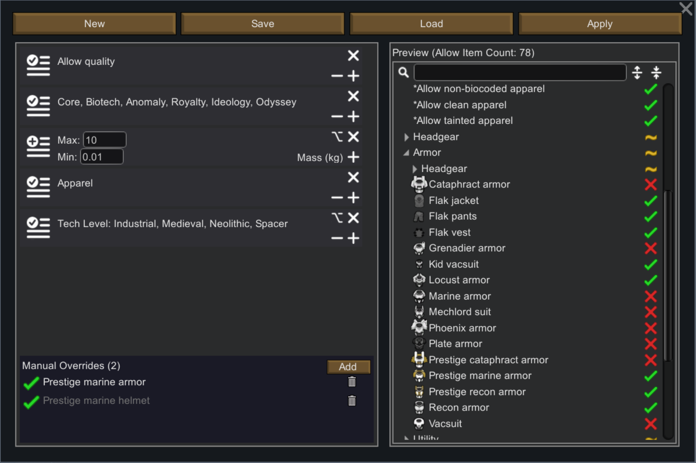

## 模组名: 更好的储存筛选 (Better Filter)

**让 RimWorld 的储存筛选器更好用——更快的分类导航、更灵活的粘贴方式、更细颗粒的物品过滤。**

### 主要功能

#### 筛选树导航优化

- 「反选」按钮:在"全部清除"与"全部允许"之间新增一键反转，快速互换允许/禁止状态。不改变筛选器本身。

- 「逐级展开/收起」按钮:搜索栏右侧新增两个箭头按键，每次展开或收起一级分类，简化手动浏览操作。

#### 粘贴储存设置增强

- 左键粘贴保持原版行为（覆盖）。

- 右键粘贴图标新增两种叠加模式:

    - 追加允许物品:当前禁止 + 剪贴板允许 → 允许

    - 追加禁止物品:当前允许 + 剪贴板禁止 → 禁止

#### 着装方案 / 食物方案增强

- 新增「复制」、「粘贴」按钮，独立于储存区的剪贴板，着装与食物各自独立。

- 新增「高级筛选」按钮，打开多条件组合过滤器，支持保存/加载筛选方案。

- 粘贴同样支持覆盖、追加允许、追加禁止三种模式。

#### 新增筛选器

本模组新增 10 个物品筛选器，按属性分为 5 对:

- 可腐坏 / 不会腐坏 —— 是否需要冷藏

- 可老化 / 不会老化 —— 置于室外是否老化（劣化速率为0等同视作不老化）

- 有品质 / 无品质 —— 是否具有品质等级

- 有耐久 / 无耐久 —— 是否具有耐久度

- 不可堆叠 / 可堆叠 —— 堆叠上限为 1 或 ≥ 2

所有新增筛选器均基于物品的固有属性，结果可预测、不会随游戏进程改变。

#### 筛选器分类与应用

- 新增筛选器与原版部分静态属性筛选器统一归入置顶的筛选器分类，便于集中使用。

- 分类中的「应用」按钮:将选中筛选器的状态向下传递到具体物品（禁止筛选器 → 禁止对应物品），再将筛选器本身重置为允许。可在模组设置中配置参与此操作的筛选器列表。

#### 高级筛选器
模组在储存区筛选以及方案管理界面增加了「高级筛选器」入口，支持复杂筛选规则:

- 支持根据模块过滤、模组过滤、类别过滤、数值过滤、枚举过滤，以及对于指定物品的手动覆盖

- 不同过滤器的结果取 **交集**（逻辑与），即应用多个过滤器时，只有满足每一个条件的物品被允许

- 同一过滤器内部条件取 **并集**（逻辑或），即满足单个过滤器内的任一条件即被允许

- 每个过滤器可选择白名单(只允许匹配物品)/黑名单(只禁止匹配物品)的匹配模式，单击过滤器左侧标志切换模式

- 对于数值和枚举值过滤器，可选择宽松(允许不具备匹配的数值属性物品)/严格(禁止不具备匹配的数值属性物品)匹配策略，单击右上角option按键切换

##### 关于每种过滤器

- **模块过滤:** `[+]` 按键添加待匹配的过滤(如 允许有耐久，允许成人衣物 等)，`[-]` 按键删除最近一次添加的过滤，可添加多种过滤；可添加的过滤列表在模组设置中决定，与可应用的过滤器列表相同

- **模组过滤:** 基于物品所属模组匹配，`[+]` 添加待匹配的模组名，可添加多个模组名，属于其中任一模组的物品即被允许

- **类别过滤:** 基于物品所属分类匹配(如 食物，制成品，原材料 等)，属于任一分类的物品即被允许

- **数值过滤:** 基于某一可取值的属性匹配物品，输入匹配的最大、最小值即可选择具有该属性且属性取值在范围内的物品，宽松策略会额外允许不具备该取值属性的物品；

  > **注释:** 本模块尚在开发中，当前仅支持堆叠数和重量匹配，未来会允许任意取值为数值类型的路径作为匹配属性

- **枚举值过滤:** 基于某一可枚举取值的属性匹配物品，`[+][-]` 按钮调节需匹配的枚举值；例如匹配属性为 科技水平，可选择枚举值包含 Medieval Industrial，则只匹配标记为中世纪和工业时代的物品；
  > **注释:** 本模块尚在开发中，当前支持武器标签、服装标签、贸易标签、科技等级、服装层级和身体覆盖部位，未来会允许任意取值为可枚举类型的路径作为匹配属性

- **手动覆盖:** 添加指定的物品定义，手动指定最终的匹配结果，此处的指定值优先生效于所有过滤器结果；覆盖不活跃(即不改变物品许可)时，物品名显示为灰色

**此外，高级筛选器可以保存，载入和追加已有的过滤器组合，并且特别为复杂模组环境匹配，导入时，由于模组变动而消失的变量名会以灰色 `*` 名称 标记，可以继续使用。**

同时，高级筛选器也允许类似**argparse命令行格式**输入过滤器:

- 模块过滤: `worker -d SpecialThingFilterDef [SpecialThingFilterDef ...] [-b] [-u]`

- 模组过滤: `mod -d PackageID [PackageID ...] [-b] [-u]`

- 类别过滤: `cat -d ThingCategoryDef [ThingCategoryDef ...] [-b] [-u]`

- 数值过滤: `value -d ValuedAttrName -v Min Max [-b] [-l] [-u]`，`-v` 接收数值时，使用字母n表示无限制，字母n加数字表示负数

- 枚举值过滤: `enum -d EnumAttrName -v EnumValue [EnumValue ...] [-b] [-l] [-u]`

- 物品策略覆盖: `item -d DefName [DefName ...] [-b] [-u]`

​	关键词 `-b` 表示过滤器采用黑名单，缺省时为默认白名单；
​	关键词 `-l` 表示采取宽松策略，缺省时为默认严格策略；
​	关键词 `-u` 表示允许不安全输入，此时无效的 `-d` 输入不会被丢弃，而是以灰色 `*` 错误名 显示在导入的过滤器中供查看，缺省时默认出现报错提示。

##### 一些命令行格式的过滤器组合

- **原版物品:** `mod -d ludeon.rimworld ludeon.rimworld.biotech ludeon.rimworld.anomaly ludeon.rimworld.royalty ludeon.rimworld.ideology ludeon.rimworld.odyssey -u` 在dlc不全时，缺失dlc的PackageID会作为错误值显示在最后，而不会影响筛选原版物品

- **可以大量堆叠的原材料:** `worker -d UR_AllowNotDeteriorating -u, value -d StackLimit -v 75 n -l -u, item -d MechanoidTransponder -b -u` 如果你没有使用修改物品堆叠上限的模组，那么这个过滤器组合会自动挑选诸如钢铁、铀矿、玻璃钢、以及其他模组加入的原材料；它们在游戏流程中会大量获取，但是由于不会老化且不会被误伤损坏，适合放置在室外的大片储存区；唯一的例外是信号转发器(MechanoidTransponder)——它也不会老化并且拥有完全不明所以的75堆叠上限

#### 模组设置
包含介绍页面和可应用筛选器配置页面，支持重置默认。

### 兼容性与性能

- 仅修改 UI 与筛选逻辑，不添加游戏内容。
- 可随时添加/移除，不影响存档。
- 与绝大多数模组兼容。
- 全部代码逻辑仅在打开相关储存筛选界面时调用，其余游戏流程中性能占用为0。

### 发布与反馈

**Github仓库:** https://github.com/uranv/BetterFilter

**Steam创意工坊:** https://steamcommunity.com/sharedfiles/filedetails/?id=3753101034

**问题反馈与建议:** 1078271304
